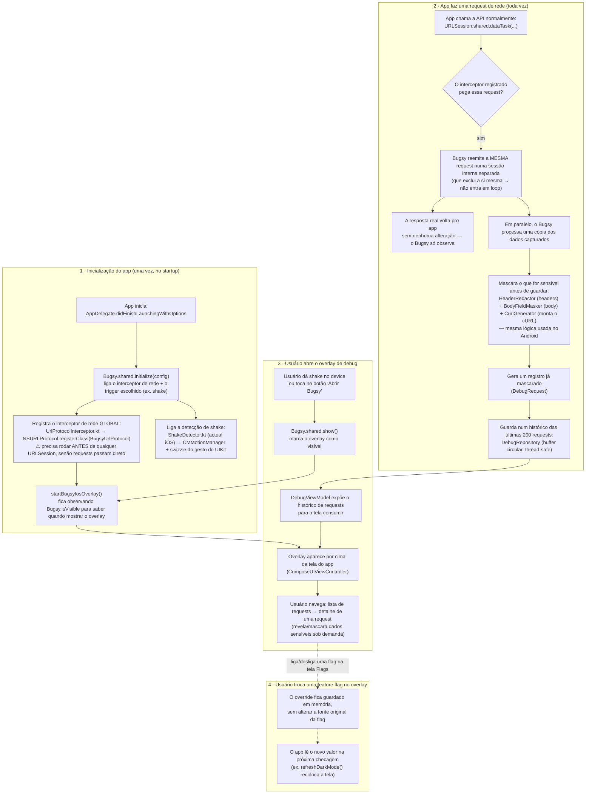

# Arquitetura do Bugsy

> Documento de referência interno — não é o README público do projeto. Serve para entender rapidamente
> **o que cada módulo e cada arquivo faz**, e como as peças se encaixam. Gerado em 2026-11-14 a partir de
> uma leitura completa do código (branch `build/DEB-31-maven-central`), e atualizado no mesmo dia após o
> merge de `main` até o PR #33 ("auto-publish to Maven Central on release") — a lógica de `core`/`ui` segue
> igual; o que mudou foi CI/release/docs e um loading state na UI (PR #32, DEB-40). Atualizado novamente
> em 2026-11-14 após o merge do PR #34: bump de versão por dropdown e gate de pré-release antes da
> publicação.

## O que é o Bugsy

Bugsy é uma biblioteca **Kotlin Multiplatform (Android + iOS)** que funciona como um "Flipper/Chucker" de
bolso embutido no próprio app: um overlay de debug que captura requests de rede, mostra feature flags,
informações de device, e permite revelar/mascarar dados sensíveis — tudo isso com uma política de
segurança "quando em dúvida, mascara" para nunca vazar segredos (tokens, senhas, CPF) por acidente.

A biblioteca é publicada no **Maven Central** sob o group `io.github.gabriela-miranda-leite`, em 3
artefatos consumidos separadamente por build type:

```kotlin
debugImplementation("io.github.gabriela-miranda-leite:bugsy-ui:0.1.0-alpha")   // -> também traz :core
releaseImplementation("io.github.gabriela-miranda-leite:bugsy-noop:0.1.0-alpha")
```

## Grafo de módulos (Gradle)

```
settings.gradle.kts
 ├─ :core            (KMP lib — captura, redação, lógica)
 ├─ :ui              (KMP lib — overlay Compose Multiplatform, depende de :core)
 ├─ :bugsy-noop      (KMP lib — mesma API pública de core+ui, zero comportamento)
 └─ :sample-android  (app Android de demonstração, não publicado)
```

- **`build.gradle.kts`** (raiz) — só declara plugins com `apply false`. Um bloco `subprojects {}` fixa
  `group`/`version` em todos os módulos a partir de `GROUP`/`VERSION_NAME` (ver `gradle.properties`) —
  isso precisa acontecer **antes** de cada módulo aplicar `com.vanniktech.maven.publish`, porque esse
  plugin lê `project.group`/`project.version` no momento em que é aplicado.
- **`gradle.properties`** — `VERSION_NAME=0.1.0-alpha`, `GROUP=io.github.gabriela-miranda-leite` (group
  público exigido pelo Maven Central), `ARTIFACT_ID=bugsy`.
- **`gradle/libs.versions.toml`** — catálogo de versões. Principais pins atuais: Kotlin 2.2.20, AGP
  8.13.0, Compose Multiplatform 1.8.2, OkHttp 4.12.0, coroutines 1.9.0, serialization 1.7.3, Paparazzi
  2.0.0-alpha05.1, e o novo plugin `mavenPublish` (`com.vanniktech.maven.publish` 0.37.0).
- **`gradle/wrapper/gradle-wrapper.properties`** — Gradle 8.13.
- **`LICENSE`** — MIT, exigida pelo Maven Central (referenciada no `pom { licenses {} }` de cada módulo).

Cada módulo publicável (`core`, `ui`, `bugsy-noop`) tem no seu `build.gradle.kts` um bloco
`mavenPublishing { coordinates(...); publishToMavenCentral(); signAllPublications(); pom {...} }` e
`signing { useGpgCmd() }`.

---

## `core/` — lógica de captura, redação e triggers

Nenhuma UI aqui. É a camada que qualquer app (com ou sem o overlay) usaria.

### `commonMain` — API pública e orquestração

| Arquivo | Responsabilidade |
|---|---|
| `Bugsy.kt` | Ponto de entrada único (`object Bugsy`). `isVisible` (StateFlow), `flagManager`, `customInfo()`. `initialize(config)`/`destroy()` ligam o interceptor + o `Trigger` escolhido. `addSensitiveHeader/removeSensitiveHeader`, `addSensitiveBodyField/removeSensitiveBodyField`, `show()`/`hide()`. |
| `BugsyConfig.kt` | Data class com as opções de `initialize()`: `trigger`, `shakeThresholdG`, `flagsProvider`, `allowRevealingSecrets`, `customInfoProvider`. |
| `CaptureSettings.kt` | Internal, um único boolean (`allowRevealingSecrets`) atrás de `MutableStateFlow`. |
| `DebugRepository.kt` | `object`, buffer circular (`ArrayDeque`, 200 entradas) de `DebugRequest`, protegido por `Mutex` de coroutine; exposto como `StateFlow`. |
| `RequestCapture.kt` | O funil que as duas plataformas chamam: redige headers (`HeaderRedactor`) e mascara body (`BodyFieldMasker`) **antes** de montar o `DebugRequest`; só anexa `RequestSecrets` se algo foi de fato mascarado **e** `allowRevealingSecrets` está ligado. |
| `HeaderRedactor.kt` | Internal; headers sensíveis padrão `authorization`, `cookie`, `x-api-key`; conjunto mutável trocado atomicamente (lido em threads de rede, escrito pela UI). |
| `BodyFieldMasker.kt` | **Arquivo mais complexo do módulo.** Campos padrão `password`, `cpf`, `token`, `secret`. Política "na dúvida, mascara", falha fechada: <br>• JSON válido → percorre a árvore recursivamente, mascara em qualquer profundidade (inclusive strings que contêm JSON embutido). <br>• Antes de parsear, mede a profundidade de aninhamento **iterativamente** (limite 64) porque o parser JSON do Kotlin/Native é recursivo e um stack overflow lá é um SIGSEGV incapturável. <br>• Qualquer coisa não-JSON (form-encoded, truncado, inválido, muito aninhado) cai num scanner **iterativo sem regex** (o motor de regex do Kotlin/Native também é recursivo; um body hostil de 1 MB derrubaria o processo). <br>• Se até o fallback de texto falhar, retorna um placeholder estático — nunca o body crú. |
| `CurlGenerator.kt` | Internal; monta o cURL mostrado na UI. Como URL/headers/body vêm de tráfego não confiável, todo argumento é escapado entre aspas simples (evita injeção de shell) e caracteres de controle são removidos. |
| `FlagManager.kt` | Por instância de `Bugsy.initialize()`; envolve o `flagsProvider` do app com um mapa de `overrides` (também protegido por mutex), para que togglar uma flag na UI tenha prioridade sem alterar a fonte real. |
| `ShakeMagnitudeDetector.kt` | Matemática pura (sem APIs de sensor, testável em `commonTest`): converte amostras x/y/z em magnitude (g), dispara `onShake` com debounce. |
| `FloatingButtonSnapCalculator.kt` | Matemática pura: dado o centro-X atual e a largura do container, decide se o botão flutuante encaixa à esquerda ou à direita. |
| `Trigger.kt` | `enum class Trigger { Shake, FloatingButton, Notification }`. |
| `DebugInterceptor.kt`, `ShakeDetector.kt`, `FloatingButtonController.kt`, `NotificationTrigger.kt` | `expect class` — implementações reais ficam em `androidMain`/`iosMain` (ver abaixo). |
| `model/DebugRequest.kt` | Data class armazenada no repositório: id, url, method, headers/body (já mascarados), statusCode, durationMs, timestamp, `curlCommand`, `metadata`, `secrets: RequestSecrets?`. |
| `model/RequestSecrets.kt` | Valores reais (sem máscara) de uma request. `toString()`/`equals`/`hashCode` sobrescritos para nunca vazar em logs/debugger. |
| `model/DebugFlag.kt` | `data class DebugFlag(key, label, value: Any, isOverridden)`. |
| `model/DeviceInfo.kt` | Campos de app/OS/device/versão do Bugsy/Kotlin/Compose mostrados na aba Device. |

### `androidMain` — actuals + integração OkHttp

| Arquivo | Responsabilidade |
|---|---|
| `BugsyContext.kt` | `internal object` com `applicationContext` (setado via `Initializer` do AndroidX, sem wiring manual) e `isHostDebuggable()` — o verdadeiro gate de "Bugsy ligado": dentro de um `.aar` publicado, o `BuildConfig.DEBUG` da própria lib é sempre o da variante release. |
| `BugsyOkHttp.kt` | `OkHttpClient.Builder.addBugsyInterceptor()`; só adiciona o interceptor se o host for debuggable (a versão do `bugsy-noop` é um passthrough). |
| `OkHttpDebugInterceptor.kt` | `Interceptor` real do OkHttp. Gate `@Volatile isActive`. Captura request/response (inclusive em `IOException`, registrando um erro antes de relançar), lê a resposta até um cap de 1 MB, e **nunca loga a exceção/mensagem capturada** (pode conter trechos de headers/body). |
| `DebugInterceptor.kt` (`actual`) | Só liga o `OkHttpDebugInterceptor` se `BugsyContext.isHostDebuggable()`. |
| `ShakeDetector.kt` (`actual`) | `SensorManager`/`TYPE_ACCELEROMETER` + `ProcessLifecycleOwner` para registrar/desregistrar no foreground/background. |
| `FloatingButtonController.kt` (`actual`) | Overlay real via `WindowManager`, drag por touch events + `ValueAnimator` de snap, pede permissão `SYSTEM_ALERT_WINDOW` se faltar. |
| `NotificationTrigger.kt` (`actual`) | Notificação fixa só com app em foreground; precisa de `POST_NOTIFICATIONS` no Android 13+ (no-op silencioso se não concedida). |

### `iosMain` — actuals + integração NSURLProtocol

| Arquivo | Responsabilidade |
|---|---|
| `DebugInterceptor.kt` (`actual`) | Gate equivalente é `Platform.isDebugBinary`. |
| `UrlProtocolInterceptor.kt` | Registra `BugsyUrlProtocol` globalmente via `NSURLProtocol.registerClass` (afeta `URLSession.shared`/config padrão). Reemite a request numa `NSURLSession` interna que **exclui** `BugsyUrlProtocol` do seu `protocolClasses` — evita interceptação recursiva. Também nunca loga a exceção de captura. |
| `IosRequestCapture.kt` | Equivalente iOS do `RequestCapture`: gera UUID, converte `NSData`→`String` (cap 1 MB), lê `HTTPBody`/`HTTPBodyStream`, e funila no mesmo `RequestCapture.build` compartilhado (redação/mascaramento idênticos entre plataformas). |
| `ShakeDetector.kt` (`actual`) | Combina `CMMotionManager` (acelerômetro) **e** o gesto de shake do UIKit via `MotionShakeHook` (CoreMotion não existe no Simulator). |
| `MotionShakeHook.kt` | Swizzle de runtime Objective-C: substitui `UIWindow.motionEnded(_:with:)` via `class_replaceMethod`, sempre chamando a implementação original depois (o app host continua recebendo o gesto normalmente). |
| `FloatingButtonController.kt` (`actual`) | `UIView` dentro de uma `UIWindow` própria sempre no topo (`windowLevel = UIWindowLevelAlert + 1`), drag via `UIPanGestureRecognizer`, snap via `animateWithDuration`. |
| `NotificationTrigger.kt` (`actual`) | iOS não tem notificação persistente equivalente — esse trigger se comporta como `Trigger.Shake`. |

### Testes (`androidUnitTest`, `commonTest`, `iosTest`)

- **`DebugRepositoryTest.kt`** — eviction do buffer circular, `clear()`, teste de concorrência (8 threads escritoras + 1 leitora).
- **`OkHttpDebugInterceptorTest.kt`** — o teste mais abrangente do módulo, contra um `MockWebServer` real: mascaramento sem alterar a resposta vista pelo app, gating de `attach()`/`detach()`, headers/campos customizados, mascaramento com body truncado, ciclo de vida via `Bugsy.initialize()`/`destroy()`, captura de erro em desconexão, 10 requests concorrentes sem `ConcurrentModificationException`.
- **`BodyFieldMaskerTest.kt`** — o teste mais pesado: casos normais + uma seção "M4" que estressa o design fail-closed (arrays JSON de 20k níveis, objetos de 5k níveis, bodies de ~1 MB hostis), garantindo que nunca vaza segredo e sempre termina em <5s.
- **`CurlGeneratorTest.kt`** — composição correta do comando + seção "M4" que faz parsing do cURL gerado como um shell POSIX faria, provando que tentativas de injeção na URL/headers/método terminam como argumento literal inerte.
- **`HeaderRedactorTest.kt`, `RequestCaptureTest.kt`, `FlagManagerTest.kt`, `FloatingButtonSnapCalculatorTest.kt`, `ShakeMagnitudeDetectorTest.kt`, `DebugInterceptorTest.kt`, `BugsyTest.kt`** — cobertura unitária do restante da lógica pura compartilhada.
- **`UrlProtocolInterceptorTest.kt`** (iOS) — lógica de `isInterceptable` (o que evita o loop de interceptação recursiva) + paridade de redação/mascaramento do `IosRequestCapture` com o caminho Android.

### Fluxo de dados: de uma request de rede a um `DebugRequest` mascarado

1. **Android**: `OkHttpDebugInterceptor.intercept()` cronometra a chamada real, lê request/response (response com cap de 1 MB via `peekBody`), chama `RequestCapture.build(...)` com os dados crus.
   **iOS**: `BugsyUrlProtocol.startLoading()` reemite a request numa sessão isolada, devolve a resposta real ao client sem alterações, e em paralelo chama `IosRequestCapture.build(...)` → `RequestCapture.build(...)`.
2. **`RequestCapture.build()`** (compartilhado): `HeaderRedactor.redact()` mascara headers sensíveis; `BodyFieldMasker.maskTracked()` mascara campos sensíveis do body; `CurlGenerator.generate()` monta o cURL a partir dos dados **já mascarados**.
3. Se algo foi de fato redigido/mascarado **e** `CaptureSettings.allowsRevealingSecrets()` é true, um segundo cURL é gerado a partir dos dados **reais** e anexado como `RequestSecrets` (só em memória, excluído do `toString()`).
4. O `DebugRequest` resultante entra no `DebugRepository` (buffer circular com `Mutex`), exposto como `StateFlow` que o módulo `ui` observa diretamente.

---

## `ui/` — overlay Compose Multiplatform

### Build

`ui/build.gradle.kts` monta um XCFramework `"Bugsy"` no iOS que exporta `:core` (assim um app Swift puro
usa tudo com um único import). Fixa `compose.resources.packageOfResClass` manualmente (independente do
`group`, que o publish plugin reescreve). As tasks de teste pinam o locale da JVM em pt-BR para que os
snapshots do compose-resources sejam determinísticos entre máquina de dev e CI.

### `commonMain` (raiz)

| Arquivo | Responsabilidade |
|---|---|
| `DebugViewModel.kt` | Ponte UI ↔ core: expõe `requests`/`flags` como `StateFlow` (vindos de `DebugRepository`/`Bugsy.flagManager`), `customInfo`, e um `deviceInfo` **ainda hardcoded/placeholder** (provider real por plataforma pendente — rastreado como DEB-3). Delega `clearRequests`/`overrideFlag`/`resetAllFlags`/`refreshFlags` para o core. |
| `PreviewFixtures.kt` | Dados de exemplo só para `@Preview` e testes de screenshot; nunca chega a um app host. |

### `commonMain/components`

Componentes reutilizáveis: `BugsySearchBar`, `BugsyTabBar` (enum `BugsyTab`: Requests/Flags/Device),
`CodeBlock` (cURL/JSON com botão de copiar), `CopyButton`/`CopyIconButton`/`CopyFlash` (feedback "Copied!"
por ~1.2–1.6s), `DragHandle`, `EmptyState`, `ExpandableSection`, `KeyValueRow`, `MethodBadge` (cor por
método HTTP), `MetricCard`, `RequestRow` (linha clicável da lista), `SectionHeader`/`SectionLabel`,
`ToggleRow`/`FlagValueRow` (switch para flags boolean, valor somente-leitura para as demais).

### `commonMain/screens`

| Arquivo | Responsabilidade |
|---|---|
| `DebugOverlay.kt` | **Composable raiz.** Modal de altura fixa (80% da tela) ancorado embaixo, sobre fundo escurecido. Entrada por `Animatable`+`tween` (240ms), saída 200ms; fecha arrastando (threshold de 25% da altura) ou tocando no fundo/X. Hospeda `BugsyTabBar` e a `SettingsScreen` atrás do botão de engrenagem. |
| `BugsySheetHeader.kt` | Barra superior: ícone + "Bugsy", botão de configurações, botão de fechar. |
| `RequestListScreen.kt` | Busca/filtro + botão de limpar tudo; `filterRequests()` é uma função top-level testada isoladamente. Mostra `RequestDetailScreen` no lugar quando uma linha é selecionada (sem lib de navegação — apenas estado local). |
| `RequestDetailScreen.kt` | Request/response completos: botão de revelar/mascarar (só aparece se `request.secrets != null`), 3 `MetricCard`s, headers como `KeyValueRow`, bodies como `CodeBlock` dentro de `ExpandableSection` (JSON bonito, auto-expandido se ≤400 chars), e o cURL. |
| `FlagsScreen.kt` | Lista de flags com botão "Reset all (N)" (só aparece se houver overrides); empty state se não houver flags. |
| `DeviceInfoScreen.kt` | Seções (Account opcional, App, Device, Runtime) com linhas chave/valor copiáveis. |
| `SettingsScreen.kt` | Toggle "revelar dados sensíveis por padrão" + versão do Bugsy. |

### `commonMain/settings` e `commonMain/theme`

- **`BugsySettings.kt`** — `object` só em memória: `revealSensitiveByDefault: StateFlow<Boolean>`.
- **`BugsyColors.kt`** — valores hex "tirados 1:1 do Figma" (comentários marcam `HeadText/HeadBg` e
  `Status3xx` como *não verificados* por falta de exemplo no Figma).
- **`BugsyColorUtils.kt`** — `methodColors()`, `statusColor()`, `formatDuration()`, `formatUrl()`.
- **`BugsyFonts.kt`, `BugsyTypography.kt`, `BugsySpacing.kt`** — fontes (Roboto/Roboto Mono), estilos de
  texto (chrome vs. código) e todas as constantes de espaçamento usadas nos componentes/telas.
- **`BugsyTheme.kt`** — `MaterialTheme(darkColorScheme(...))` — o overlay é **dark-only**, Material3 é
  mais um host de widgets (Switch, OutlinedButton) do que a fonte de design tokens (isso vem de
  `BugsyColors`/`BugsyTypography`/`BugsySpacing` diretamente).
- **`JsonPrettyPrint.kt`** — pretty-printer de JSON recursivo feito à mão; retorna o input sem alteração
  em qualquer falha de parsing (não é código crítico de segurança como o `BodyFieldMasker`, então a
  recursão aqui é aceitável).

### `androidMain` / `iosMain`

- **`BugsyAndroidOverlay.kt`** — composable de entrada (embute uma vez na árvore da Activity host); mostra
  um `Dialog` full-screen reagindo a `Bugsy.isVisible`.
- **`BugsyIosOverlay.kt`** — `startBugsyIosOverlay()` (chamar uma vez no startup); observa
  `Bugsy.isVisible` e apresenta/dispensa um `ComposeUIViewController` sobre o root view controller atual.

### Testes

- **`BugsyScreenshotTest.kt`** (Paparazzi, `androidUnitTest`) — cobre cada componente/tela visualmente
  distinta, incluindo o `DebugOverlay` composto em 4 estados. Precisa de um hack via reflection para setar
  o `Context` do compose-resources (Paparazzi não dispara o `ContentProvider` que normalmente faz isso).
- **`BugsySettingsTest.kt`, `DebugViewModelTest.kt`, `RequestListScreenTest.kt`, `BugsyColorUtilsTest.kt`,
  `JsonPrettyPrintTest.kt`** (`commonTest`) — cobertura unitária da lógica de UI que não depende de
  renderização real.

---

## `bugsy-noop/` — artefato de release (zero comportamento)

Existe para que `releaseImplementation(bugsy-noop)` compile exatamente contra a mesma API pública que
`debugImplementation(ui)` (que traz `core` transitivamente), sem nenhuma instrumentação em produção.

| Arquivo | Responsabilidade |
|---|---|
| `Bugsy.kt` (commonMain) | `object Bugsy` espelhando a API pública real (`version="noop"`, `isVisible` sempre `false`); todo método é `= Unit`. |
| `BugsyConfig.kt` | Mesma forma da data class real, para os call sites compilarem sem alteração. |
| `FlagManager.kt` | `flags` é um `StateFlow` sempre `emptyList()`; `value(key)` sempre `null` — garante que o app em release sempre caia nos valores padrão reais. |
| `Trigger.kt`, `model/DebugFlag.kt` | Duplicados do `core` propositalmente, para `bugsy-noop` não depender de `core`. |
| `BugsyOkHttp.kt` (androidMain) | `addBugsyInterceptor()` no-op, retorna o builder sem alterações. |
| `BugsyAndroidOverlay.kt` (androidMain) | Função comum (não `@Composable`) — esse artefato não tem dependência do Compose, mas ainda pode ser chamada de dentro de qualquer Composable do app. |
| `BugsyIosOverlay.kt` (iosMain) | `startBugsyIosOverlay()` no-op. |
| `BugsyNoopTest.kt` | Garante que cada ponto de entrada é de fato no-op: `show()` nunca altera `isVisible`, `initialize()` nunca invoca os providers, `FlagManager` nunca guarda overrides. |

---

## `sample-android/` — app de demonstração (não publicado)

| Arquivo | Responsabilidade |
|---|---|
| `build.gradle.kts` | `debugImplementation(project(":ui"))` / `releaseImplementation(project(":bugsy-noop"))` — a demonstração real do padrão de troca por build type. |
| `ApiSurface.kt` | Exercita **toda** a API pública do Bugsy (todas as chamadas `Bugsy.*`, `FlagManager.*`, `BugsyConfig`, `Trigger`, `addBugsyInterceptor()`, `BugsyAndroidOverlay()`). Nunca é executado em runtime — sua única função é fazer `assembleRelease` parar de compilar se a API pública de `core`+`ui` mudar e `bugsy-noop` não acompanhar, pegando regressões de paridade de API em build time. |
| `MainActivity.kt` | Client OkHttp real com `addBugsyInterceptor()`; botões para disparar uma request e abrir o Bugsy; demonstra override de flag em tempo real (`darkModeEnabled` muda a cor da tela via `collectAsState()`, sem reiniciar o app). |
| `SampleApp.kt` | `Application.onCreate()` chama `Bugsy.initialize(trigger = Trigger.Notification, ...)` com um `flagsProvider` e `customInfoProvider` estáticos de exemplo. |

---

## `sample-ios/` — app de demonstração Swift puro (não publicado, fora do Gradle)

Projeto Xcode puro (`BugsySample.xcodeproj`), sem KMP do lado dele — equivalente ao `sample-android`,
mas em Swift. Não aparece no grafo Gradle (`settings.gradle.kts`) porque só *consome* o framework que o
Gradle gera; não é buildado pelo Gradle.

| Arquivo | Responsabilidade |
|---|---|
| `BugsySample.xcodeproj` | Projeto Xcode; escolhe o framework pela configuração de build: **Debug** → `ui/build/bin/<target>/debugFramework/Bugsy.framework` (completo); **Release** → `bugsy-noop/build/bin/<target>/releaseFramework/Bugsy.framework` (no-op). Tem uma Run Script phase ("Copy Compose Resources") que copia `compose-resources/` (strings/fontes do overlay) pro bundle do app — sem isso o overlay crasha ao abrir. |
| `Sources/AppDelegate.swift` | `didFinishLaunchingWithOptions`: chama `Bugsy.shared.initialize(config:)` **antes** de qualquer `URLSession` ser criada (registra o `NSURLProtocol` globalmente) e, depois de criar a `window`, `BugsyIosOverlayKt.startBugsyIosOverlay()` (observa `Bugsy.isVisible` e apresenta o overlay). |
| `Sources/ViewController.swift` | Botão "Fazer request" (`URLSession.shared` com header `Authorization: Bearer sample-secret`) e "Abrir Bugsy" (`Bugsy.shared.show()`); `refreshDarkMode()` em `viewDidAppear` prova que um override de flag feito dentro do `FlagsScreen` chega de volta ao app host sem reiniciar; bloco `BUGSY_SAMPLE_AUTORUN` dispara request+show automaticamente após 3s (validação sem interação, ex. CI). |

### Fluxograma: de `AppDelegate` a uma request mascarada na tela



Como ler o fluxograma: **4 fases independentes**, não um único caminho linear. A inicialização (1) roda uma vez; a captura de rede (2) roda a cada request, mesmo com o overlay fechado; abrir o overlay (3) e trocar uma flag (4) são ações do usuário que podem acontecer em qualquer ordem, inclusive sem nunca ter havido uma request capturada.

Pontos que o fluxograma deixa explícitos:
- **Dois caminhos de entrada no overlay**: via rede (request interceptada → `DebugRepository` → UI) e via trigger (shake/botão → `isVisible` → overlay abre, independente de ter request ou não).
- **Sem loop de interceptação**: a sessão interna que reemite a request exclui a própria `BugsyUrlProtocol` do `protocolClasses`.
- **O app nunca percebe o Bugsy**: a resposta devolvida ao app é sempre a real, sem alteração; só a cópia que vai para o histórico é mascarada.
- **Mesma lógica de mascaramento e mesma UI** entre Android e iOS — só o ponto de captura (`OkHttpDebugInterceptor` vs. `BugsyUrlProtocol`/`IosRequestCapture`) é específico de plataforma.

---

## Publicação no Maven Central

- Group: `io.github.gabriela-miranda-leite` (antes era `com.bugsy`, trocado para o group público exigido
  pelo Sonatype/Central).
- Plugin: `com.vanniktech.maven.publish` (substitui o `maven-publish` + `jitpack.yml` antigos — o
  `jitpack.yml` foi removido nesta mesma branch).
- Cada módulo publicável assina com `signing { useGpgCmd() }` e preenche `pom { licenses/developers/scm }`
  apontando para o MIT `LICENSE` e o repositório no GitHub.
- `core` e `ui` publicam `androidVariantsToPublish = ["release"]` com `KotlinMultiplatform(javadocJar =
  JavadocJar.Empty())`.

## CI/CD e release

O `ci.yml` único foi dividido por responsabilidade em `.github/workflows/`:

| Workflow | O que faz |
|---|---|
| `android.yml` | Build + testes unitários/instrumentados Android. |
| `ios.yml` | Build + testes iOS (job de macOS isolado do resto, acelerado no PR #31/DEB-39). |
| `snapshots.yml` | Roda os testes de screenshot do Paparazzi e publica as diferenças visuais no PR. |
| `coverage.yml` | Gera cobertura via **Kover** e publica no Codecov (badge no README). |
| `secrets-scan.yml` | `gitleaks` em todo PR e push em `main`, para pegar segredo commitado por engano. |
| `pre-release.yml` | Gate de instalação real, antes de qualquer publish (PR #34). `workflow_call` (chamado pelo `release.yml`) + `workflow_dispatch` (pode rodar isolado, sem disparar um release). Dois jobs em paralelo: **Android** — publica `bugsy-core`/`ui`/`noop` com uma versão rc descartável (`<core>-rc.<run_id>`) no `mavenLocal` do runner (assinatura pulada via `-PbugsySkipSigning`), builda o sample consumindo essa versão publicada via `-PbugsyFromMavenLocal` (não mais `project(":ui")`), sobe um emulador, instala o APK e confere no logcat que abriu sem `FATAL EXCEPTION`. A versão rc publicada também sobe como artifact do workflow (`actions/upload-artifact`), com instruções no `$GITHUB_STEP_SUMMARY` pra quem quiser baixar e testar num projeto local. **iOS** — builda o `.xcframework` real (mesmas tasks que um app Swift usaria), resolve dinamicamente um simulador iPhone disponível na imagem do runner, instala e abre o sample, confere que o processo continua de pé. |
| `release.yml` | `workflow_dispatch` manual: só `gabriela-miranda-leite` pode disparar (checado no primeiro step). Inputs mudaram de versão em texto livre para um dropdown `bump` (`patch`/`minor`/`major`) + sufixo opcional de pre-release (PR #34) — job `compute-version` lê o `VERSION_NAME` atual, descarta um sufixo antigo e calcula a próxima versão, validando que a tag ainda não existe (sem risco de erro de digitação). O job `release` só roda depois que `pre-release.yml` passa como gate; aí sim sobe `VERSION_NAME` em `gradle.properties` numa branch `release/vX`, abre e faz squash-merge do PR contornando a proteção de branch (`gh pr merge --admin`, usando `RELEASE_PAT`), cria a tag e a GitHub Release com changelog automático, e **no mesmo job** roda `./gradlew publishAndReleaseToMavenCentral` (credenciais do Maven Central + chave GPG vindas de secrets) — publicar no Maven Central deixou de ser um passo manual separado (PR #33). |

- **`.github/CODEOWNERS`** — exige review de `gabriela-miranda-leite` antes de qualquer merge em `main`; é
  o motivo de `release.yml` precisar do `--admin`/`RELEASE_PAT` para contornar a proteção de branch no fluxo
  automático.
- **`scripts/check-release-clean.sh`** — gate que prova que um build de **release** não carrega rastro da
  instrumentação de debug: escaneia `.dex` em busca das classes de `core`/`ui` (`DebugRepository`,
  `OkHttpDebugInterceptor`, `BodyFieldMasker` etc.), confere que o manifest não declara
  `SYSTEM_ALERT_WINDOW`/`POST_NOTIFICATIONS`, e em iOS varre símbolos (`nm`) do binário por nomes como
  `UrlProtocolInterceptor`/`MotionShakeHook`. Reprova (`exit 1`) se achar qualquer rastro — é a verificação
  concreta por trás da promessa de "zero comportamento" do `bugsy-noop`.
- **`scripts/smoke-test-android.sh` / `scripts/smoke-test-ios.sh`** (PR #34) — instalam o sample já
  compilado num emulador/simulador já de pé, abrem e confirmam que o processo continua rodando e não
  logou `FATAL EXCEPTION` (Android) / não morreu depois do launch (iOS). É o que o `pre-release.yml` chama
  pra validar a instalação de verdade, não só a compilação.
- **`-PbugsySkipSigning` / `-PbugsyFromMavenLocal`** (PR #34) — flags de Gradle só usadas pelo
  `pre-release.yml`: a primeira pula `signAllPublications()`/`signing {}` em `core`/`ui`/`bugsy-noop` (só
  faz sentido pra um publish efêmero no `mavenLocal`, nunca pro Maven Central real); a segunda faz
  `sample-android` trocar `debugImplementation(project(":ui"))`/`releaseImplementation(project(":bugsy-noop"))`
  por uma dependência Maven de verdade (`io.github.gabriela-miranda-leite:bugsy-ui:<versão>`), e só nesse
  caso `settings.gradle.kts` adiciona `mavenLocal()` aos repositórios.
- **`scripts/verify-signature.md`** — passo a passo para quem consome a lib verificar a assinatura GPG dos
  artefatos publicados no Maven Central.

## TODOs conhecidos

Nenhum TODO pendente no código neste momento (os 4 que existiam — validação manual de
shake/floating-button em device real, Android e iOS — já foram verificados e removidos).
