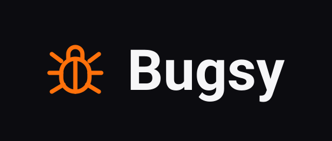

<p align="center">
  
</p>

<p align="center">
<a href="https://central.sonatype.com/namespace/io.github.gabriela-miranda-leite"></a>
<a href="https://github.com/gabriela-miranda-leite/bugsy/actions/workflows/android.yml"></a>
<a href="https://github.com/gabriela-miranda-leite/bugsy/actions/workflows/ios.yml"></a>
<a href="https://codecov.io/gh/gabriela-miranda-leite/bugsy"></a>
<a href="https://github.com/gabriela-miranda-leite/bugsy/blob/main/scripts/verify-signature.md"></a>
<a href="LICENSE"></a>
</p>

<p align="center">
<a href="README.md">🇧🇷 Português</a> · 🇺🇸 English
</p>

Bugsy is a **Kotlin Multiplatform (Android + iOS)** library that works like a pocket-sized
"Flipper/Chucker" embedded right into the app: a debug overlay that captures network requests,
shows feature flags and device info, and lets you reveal/mask sensitive data — with a
"when in doubt, mask it" security policy so secrets (tokens, passwords, national IDs) never leak
by accident.

## Table of contents

- [Demo](#demo)
- [Installation](#installation)
  - [Kotlin / Android](#kotlin--android)
  - [Swift / iOS](#swift--ios)
  - [React Native](#react-native)
  - [Flutter](#flutter)
- [Basic usage](#basic-usage)
- [Modules](#modules)
- [Security](#security)
- [About development](#about-development)

## Demo

| Android | iOS |
|---|---|
| _video/GIF coming soon_ | _video/GIF coming soon_ |

## Installation

Published on **Maven Central** under the group `io.github.gabriela-miranda-leite`.

### Kotlin / Android

3 artifacts consumed separately by build type:

```kotlin
dependencies {
    // Full overlay (pulls in :core transitively), debug only.
    debugImplementation("io.github.gabriela-miranda-leite:bugsy-ui:0.1.0-alpha")

    // Same public API, zero instrumentation, for release.
    releaseImplementation("io.github.gabriela-miranda-leite:bugsy-noop:0.1.0-alpha")
}
```

### Swift / iOS

Bugsy also runs in **pure Swift** apps (no KMP needed), via `Bugsy.xcframework`:

```sh
# Debug: full Bugsy
./gradlew :ui:linkDebugFrameworkIosSimulatorArm64 :ui:iosSimulatorArm64AggregateResources
# Release: no-op artifact (same API, no instrumentation)
./gradlew :bugsy-noop:linkReleaseFrameworkIosSimulatorArm64
```

The resources task (`...AggregateResources`) generates the overlay's strings and fonts and only
exists on the Debug target — without it the app may use stale resources and crash when opening the
overlay. To run on a physical device, swap `iosSimulatorArm64` for `iosArm64`.

```swift
// AppDelegate.application(_:didFinishLaunchingWithOptions:)
Bugsy.shared.initialize(
    config: BugsyConfig(
        trigger: .shake,
        shakeThresholdG: BugsyConfig.companion.DEFAULT_SHAKE_THRESHOLD_G,
        flagsProvider: { [] },
        allowRevealingSecrets: true // false hides the "Copy with real values" button
    )
)
// ...after creating the window:
BugsyIosOverlayKt.startBugsyIosOverlay()
```

`Bugsy.initialize` needs to run **before** any `URLSession` is created (it registers Bugsy's
`NSURLProtocol`). In release, link the `:bugsy-noop` framework, not `:ui` — it doesn't contain the
interceptor. See [`sample-ios/README.md`](sample-ios/README.md) for the full step-by-step,
including copying the overlay resources in Xcode.

### React Native

Bugsy is a native library (Kotlin/Swift) and **has no JS binding today** — you can't `import` it
directly into a React Native app. Using it in RN would require writing a native module (Turbo
Module/Native Module) wrapping the `Bugsy.*` calls on the Android and iOS side. That wrapper
doesn't exist yet; it's future work.

### Flutter

Same situation as React Native: **no Flutter plugin today**. Integrating it would require a
Platform Channel (or Federated Plugin) calling native Bugsy on each platform. That plugin doesn't
exist yet; it's future work.

## Basic usage

```kotlin
// Application.onCreate()
Bugsy.initialize(
    trigger = Trigger.Shake,
    flagsProvider = { listOf(DebugFlag("darkModeEnabled", "Dark mode", false)) },
)

// OkHttp client (Android)
OkHttpClient.Builder()
    .addBugsyInterceptor()
    .build()
```

On iOS, call `startBugsyIosOverlay()` once at app startup to observe `Bugsy.isVisible`.

## Modules

```
settings.gradle.kts
 ├─ :core            (KMP lib — capture, redaction, logic)
 ├─ :ui              (KMP lib — Compose Multiplatform overlay, depends on :core)
 ├─ :bugsy-noop      (KMP lib — same public API as core+ui, zero instrumentation)
 └─ :sample-android  (Android demo app, not published)
```

- **`core`** — request capture (OkHttp interceptor on Android, `NSURLProtocol` on iOS), header
  redaction and sensitive body field masking, feature flags, and the triggers (shake, floating
  button, notification) that open the overlay.
- **`ui`** — Compose Multiplatform overlay: request list, request/response detail, flags and
  device info.
- **`bugsy-noop`** — artifact for release builds: same public API as `core`+`ui`, with no
  instrumentation at all.

## Security

Sensitive headers (`authorization`, `cookie`, `x-api-key`, ...) and body fields (`password`,
national ID fields, `token`, `secret`, ...) are masked by default before any data reaches the UI or
the exported `cURL`. Real data only ever lives in memory, never in logs, and only becomes available
if explicitly revealed in the overlay's settings screen.

In release, `bugsy-noop` replaces `ui`/`core` with an artifact that has no behavior at all — the
actual gate, though, is that the interceptor/`NSURLProtocol` is only activated if the host is
debuggable, even when the full artifact is on the classpath.

## About development

This project was developed with AI assistance ([Claude Code](https://claude.com/claude-code)),
with human review on every PR.
