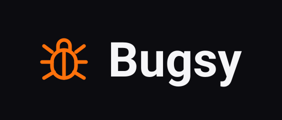

<p align="center">
  
</p>

<p align="center">
<a href="https://central.sonatype.com/namespace/io.github.gabriela-miranda-leite"></a>
<a href="https://github.com/gabriela-miranda-leite/bugsy/actions/workflows/android.yml"></a>
<a href="https://github.com/gabriela-miranda-leite/bugsy/actions/workflows/ios.yml"></a>
<a href="https://codecov.io/gh/gabriela-miranda-leite/bugsy"></a>
<a href="https://github.com/gabriela-miranda-leite/bugsy/blob/main/scripts/verify-signature.md"></a>
<a href="LICENSE"></a>
</p>

Bugsy é uma biblioteca **Kotlin Multiplatform (Android + iOS)** que funciona como um
"Flipper/Chucker" de bolso embutido no próprio app: um overlay de debug que captura requests de
rede, mostra feature flags, informações de device, e permite revelar/mascarar dados sensíveis —
com uma política de segurança "quando em dúvida, mascara" para nunca vazar segredos (tokens,
senhas, CPF) por acidente.

## Demonstração

| Android | iOS |
|---|---|
| _vídeo/GIF em breve_ | _vídeo/GIF em breve_ |

## Instalação

Publicado no **Maven Central** sob o group `io.github.gabriela-miranda-leite`, em 3 artefatos
consumidos separadamente por build type:

```kotlin
dependencies {
    // Overlay completo (traz :core transitivamente) só em debug.
    debugImplementation("io.github.gabriela-miranda-leite:bugsy-ui:0.1.0-alpha")

    // Mesma API pública, zero instrumentação, em release.
    releaseImplementation("io.github.gabriela-miranda-leite:bugsy-noop:0.1.0-alpha")
}
```

## Uso básico

```kotlin
// Application.onCreate()
Bugsy.initialize(
    trigger = Trigger.Shake,
    flagsProvider = { listOf(DebugFlag("darkModeEnabled", "Dark mode", false)) },
)

// Client OkHttp (Android)
OkHttpClient.Builder()
    .addBugsyInterceptor()
    .build()
```

No iOS, chame `startBugsyIosOverlay()` uma vez no startup do app para observar `Bugsy.isVisible`.

## Módulos

```
settings.gradle.kts
 ├─ :core            (KMP lib — captura, redação, lógica)
 ├─ :ui              (KMP lib — overlay Compose Multiplatform, depende de :core)
 ├─ :bugsy-noop      (KMP lib — mesma API pública de core+ui, zero instrumentação)
 └─ :sample-android  (app Android de demonstração, não publicado)
```

- **`core`** — captura de requests (interceptor OkHttp no Android, `NSURLProtocol` no iOS),
  redação de headers e mascaramento de campos sensíveis do body, feature flags e os triggers
  (shake, botão flutuante, notificação) que abrem o overlay.
- **`ui`** — overlay Compose Multiplatform: lista de requests, detalhe de request/response,
  flags e device info.
- **`bugsy-noop`** — artefato para builds de release: mesma API pública de `core`+`ui`, sem
  nenhuma instrumentação.

## Segurança

Headers (`authorization`, `cookie`, `x-api-key`, ...) e campos de body (`password`, `cpf`,
`token`, `secret`, ...) sensíveis são mascarados por padrão antes de qualquer dado chegar à UI ou
ao `cURL` exportado. Dados reais só ficam disponíveis em memória, nunca em log, e só se
explicitamente revelados na tela de settings do overlay.

Em release, `bugsy-noop` substitui `ui`/`core` por um artefato sem nenhum comportamento — o
gate real, porém, é que o interceptor/`NSURLProtocol` só é ativado se o host for debuggable,
mesmo quando o artefato completo está no classpath.

## Sobre o desenvolvimento

Este projeto foi desenvolvido com apoio de IA ([Claude Code](https://claude.com/claude-code)),
com revisão humana de cada PR.
