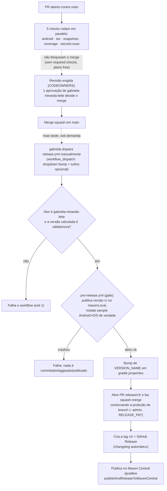

## Visão geral

O antigo `ci.yml` único foi dividido em 7 workflows independentes, cada um com sua própria responsabilidade. Cinco rodam automaticamente (em todo PR e em push em `main`); os outros dois (`pre-release` e `release`) fazem parte do fluxo de publicação.

- **Rodam em todo PR e em push em `main`**: `android`, `ios`, `snapshots`, `coverage`, `secrets-scan`.
- **Gate antes de publicar** (PR #34): `pre-release` — chamado automaticamente pelo `release` (`workflow_call`), e também pode ser disparado isolado via `workflow_dispatch` pra testar a `main` sem iniciar um release de verdade.
- **Só roda quando alguém dispara**: `release` (`workflow_dispatch`), restrito a `gabriela-miranda-leite`.
- `android`, `ios` e `coverage` ignoram mudanças só em `.md`/`assets/**` (não recompilam por um ajuste de documentação).

## Fluxo de um PR até o release



O PR dispara os 5 checks de uma vez. Como o repositório está no plano free do GitHub, nenhum deles é um *required check*: o que de fato decide se o PR pode ir pra `main` é a revisão obrigatória do CODEOWNERS (1 aprovação de `gabriela-miranda-leite`). O release é um fluxo separado, disparado manualmente quando quiser publicar uma versão nova — e agora passa primeiro pelo gate de pré-release antes de tocar em versão, tag ou Maven Central.

## Cada workflow em detalhe

| Workflow | Quando roda | Runner | O que faz | Bloqueia o merge? |
| --- | --- | --- | --- | --- |
| `android.yml` | PR e push em `main` | `ubuntu-latest` | Testes unitários de `core`+`bugsy-noop`, build do `sample-android` (debug e release), e o gate `check-release-clean.sh --apk` (prova que o release não tem rastro de instrumentação). | Não (sem required checks), mas falha fica visível no PR. |
| `ios.yml` | PR e push em `main` | `macos-latest` | Testes no simulador iOS (`core`, `bugsy-noop`, `ui`), build do framework + do `sample-ios` em Release, e o mesmo gate via `check-release-clean.sh --ios` (procura símbolos de instrumentação no binário). | Não. |
| `snapshots.yml` | PR e push em `main` | `macos-latest` | Roda os testes de screenshot do Paparazzi (`:ui:verifyPaparazziDebug`) e, se falhar, sobe as diferenças visuais como artifact do PR. | Não — `continue-on-error: true` de propósito (imagens de referência gravadas no Mac de dev variam um pouco no runner). |
| `coverage.yml` | PR e push em `main` | `ubuntu-latest` | Gera cobertura combinada de `core`+`ui` via **Kover** e publica no Codecov (só JVM/Android — não instrumenta os alvos iOS). | Não. |
| `secrets-scan.yml` | PR e push em `main` | `ubuntu-latest` | `gitleaks` em busca de segredo commitado por engano. | Não (mas é o mais crítico de olhar se falhar). |
| `pre-release.yml` | Chamado pelo `release.yml` (`workflow_call`) + manual (`workflow_dispatch`) | `ubuntu-latest` + `macos-latest` (jobs em paralelo) | Publica `bugsy-core`/`ui`/`noop` com uma versão rc descartável no `mavenLocal` do runner (sem assinatura), builda e instala o sample Android num emulador e o sample iOS num simulador, confere que abriram sem crashar. Sobe a versão rc como artifact do workflow pra quem quiser testar manualmente. | N/A (não roda em PR; é o gate do `release.yml`). |
| `release.yml` | Só manual (`workflow_dispatch`) | `ubuntu-latest` | Calcula a versão (bump + sufixo opcional), espera o `pre-release.yml` passar, só então faz bump de `VERSION_NAME`, PR + squash-merge, tag, GitHub Release e `./gradlew publishAndReleaseToMavenCentral` — ver seção "Como disparar um release" abaixo. | N/A (não roda em PR). |

`android.yml`, `coverage.yml` e `ios.yml` ignoram mudanças só em `.md`/`assets/**`/arquivos do outro SO, para não recompilar à toa num PR só de documentação.

## Proteção de branch e CODEOWNERS

`.github/CODEOWNERS` tem uma única regra: `* @gabriela-miranda-leite`, ou seja, todo arquivo do repositório exige review de `gabriela-miranda-leite` antes de mergear em `main`. Como o repositório está no plano free do GitHub, não dá pra marcar nenhum workflow como *required status check*; a proteção de branch hoje é basicamente essa exigência de review.

Isso cria um problema pro `release.yml`: ele precisa commitar o bump de versão e mergear sozinho, sem um humano aprovando. A saída foi contornar a proteção só nesse fluxo específico:

- O workflow usa um **Personal Access Token** (`RELEASE_PAT`, não o `GITHUB_TOKEN` padrão) com permissão de admin no repositório.
- `gh pr merge --admin` usa essa permissão pra fazer o squash-merge contornando a regra de review, só nesse PR automático de release.
- O próprio workflow já se restringe por fora: o primeiro step falha com `exit 1` se `github.actor` não for `gabriela-miranda-leite`, então mesmo quem tem acesso ao repositório não consegue disparar um release em nome de outra pessoa.

## Como disparar um release

1. Na aba **Actions** do GitHub, abrir o workflow **Release** e rodar via **Run workflow**, escolhendo o `bump` (`patch`/`minor`/`major`) e, se quiser, um sufixo de pre-release (ex.: `alpha`, `rc1`). Não existe mais campo de versão em texto livre. Só funciona logado como `gabriela-miranda-leite`.
2. O job `compute-version` lê o `VERSION_NAME` atual do `gradle.properties`, descarta um sufixo antigo, aplica o bump escolhido e confere que a tag `vX.Y.Z` resultante ainda não existe.
3. **Gate de pré-release**: antes de qualquer commit, o `pre-release.yml` roda como dependência do job `release` — publica uma versão rc descartável no `mavenLocal` do runner e instala os samples Android e iOS de verdade num emulador/simulador. Se crashar em qualquer plataforma, o resto do release não roda. Ver `bugsy-deploy-maven-central.md` para o detalhe desse gate.
4. Passando o gate, sobe `VERSION_NAME` em `gradle.properties`, numa branch `release/vX.Y.Z`, e abre + faz squash-merge do PR (contornando a proteção de branch, como explicado acima).
5. Cria a tag `vX.Y.Z` e a GitHub Release, com changelog gerado automaticamente a partir dos commits.
6. No mesmo job, depois de criar a tag e a Release, o workflow já roda `./gradlew publishAndReleaseToMavenCentral` (credenciais do Maven Central + chave de assinatura GPG vindas de secrets). A publicação no Maven Central deixou de ser um passo manual separado e agora acontece dentro do próprio `release.yml`.

## Deploy: como o artefato chega no Maven Central

O "deploy" do Bugsy é a parte final do `release.yml` (passo 6 acima, depois do gate de pré-release). Em detalhe:

### O que é publicado

3 artefatos, cada um com seu `build.gradle.kts` configurando o plugin `com.vanniktech.maven.publish` (`mavenPublishing { ... }`):

| Artefato | Coordenada | Módulo |
| --- | --- | --- |
| `bugsy-core` | `io.github.gabriela-miranda-leite:bugsy-core` | `core/` |
| `bugsy-ui` | `io.github.gabriela-miranda-leite:bugsy-ui` | `ui/` |
| `bugsy-noop` | `io.github.gabriela-miranda-leite:bugsy-noop` | `bugsy-noop/` |

Os três usam `configure(KotlinMultiplatform(javadocJar = JavadocJar.Empty(), androidVariantsToPublish = listOf("release")))`: só a variante `release` do Android é publicada (nunca `debug`), e o Javadoc jar fica vazio (projeto Kotlin, não tem Javadoc de verdade — mas o Maven Central exige o jar existir). `GROUP` (`io.github.gabriela-miranda-leite`) e `VERSION_NAME` vêm do `gradle.properties` da raiz, aplicados a todos os módulos pelo bloco `subprojects {}` do `build.gradle.kts` raiz.

### Assinatura GPG

Cada módulo chama `signAllPublications()` e configura `signing { ... }` com dois caminhos possíveis:

```kotlin
signing {
    if (System.getenv("CI") != null) {
        useInMemoryPgpKeys(System.getenv("SIGNING_KEY"), System.getenv("SIGNING_PASSWORD"))
    } else {
        useGpgCmd()
    }
}
```

- **No CI**: a chave privada completa vem em texto (armazenada nos secrets `SIGNING_KEY`/`SIGNING_PASSWORD` do repositório) e é carregada em memória — não depende de um keyring instalado no runner.
- **Localmente** (se alguém rodar o publish na própria máquina): usa o `gpg` já configurado no sistema (`useGpgCmd()`), que pede a senha da chave de forma interativa.

A chave usada é a mesma documentada em `scripts/verify-signature.md` (fingerprint `C026 9B73 BD9E 7E27 C142 0484 0924 C1EA 9E8E 5D86`), e é ela que qualquer pessoa pode usar para verificar que um artefato baixado do Maven Central realmente saiu desse pipeline e não foi adulterado no caminho.

### Credenciais e o passo de publish

```yaml
- name: Publish to Maven Central
  env:
    ORG_GRADLE_PROJECT_mavenCentralUsername: ${{ secrets.MAVEN_CENTRAL_USERNAME }}
    ORG_GRADLE_PROJECT_mavenCentralPassword: ${{ secrets.MAVEN_CENTRAL_PASSWORD }}
    SIGNING_KEY: ${{ secrets.SIGNING_KEY }}
    SIGNING_PASSWORD: ${{ secrets.SIGNING_PASSWORD }}
  run: ./gradlew publishAndReleaseToMavenCentral --no-configuration-cache
```

- O prefixo `ORG_GRADLE_PROJECT_` é a convenção do Gradle pra injetar uma env var como propriedade de projeto (`mavenCentralUsername`/`mavenCentralPassword`), que é exatamente o que o plugin `vanniktech` espera pra autenticar na API do **Central Portal** (substituto atual do antigo OSSRH/Nexus).
- `--no-configuration-cache`: o plugin de publish não é totalmente compatível com o configuration cache do Gradle, então esse step desliga o cache só pra essa chamada.
- **`publishAndReleaseToMavenCentral` vs `publishToMavenCentral`**: o plugin gera as duas tasks. A primeira só faz upload pro Central Portal e para numa validação (ficaria pendente até alguém clicar "Release" manualmente na UI do Central Portal). A que o workflow usa, `publishAndReleaseToMavenCentral`, faz upload **e** libera automaticamente assim que a validação passa — é o que torna o processo 100% sem clique manual.
- Nenhum `SonatypeHost` é configurado explicitamente em nenhum módulo — o plugin usa o Central Portal por padrão (a versão mais nova do fluxo do Sonatype, que substituiu o antigo `oss.sonatype.org`).

### Do clique no "Run workflow" até o artefato disponível

1. Os três módulos (`core`, `ui`, `bugsy-noop`) são empacotados, assinados e enviados ao Central Portal numa única chamada (`publishAndReleaseToMavenCentral` roda nos três subprojetos que têm o plugin aplicado).
2. O Central Portal valida o bundle (POM completo com licença/developers/SCM, assinatura GPG presente, Javadoc e sources jars presentes) — é por isso que o `pom { licenses {}; developers {}; scm {} }` de cada módulo precisa estar preenchido; um bundle incompleto é rejeitado na validação.
3. Passando na validação, a liberação é automática (por causa do `publishAndReleaseToMavenCentral`) — não existe uma aprovação manual no meio.
4. A sincronização para `repo1.maven.org` (o mirror público que qualquer `mavenCentral()` do Gradle/Maven consulta) leva alguns minutos depois da liberação; não é instantâneo.
5. A partir daí, `debugImplementation("io.github.gabriela-miranda-leite:bugsy-ui:X.Y.Z")` e `releaseImplementation("io.github.gabriela-miranda-leite:bugsy-noop:X.Y.Z")` já resolvem a versão nova pra quem consome a lib.
