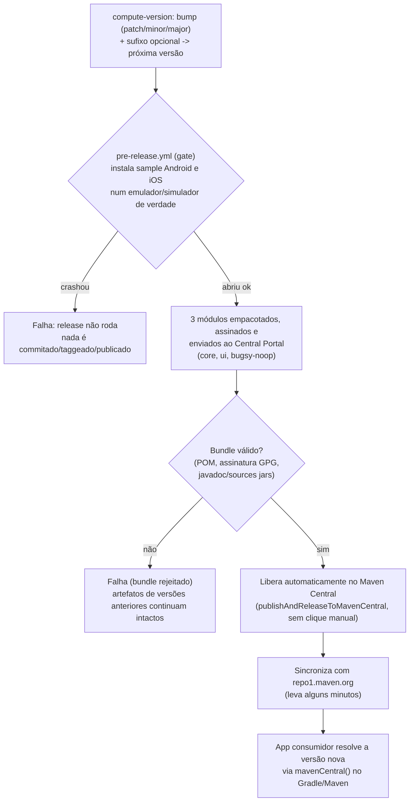

# Bugsy – Deploy no Maven Central

Nov 14, 2026 · @Gabi

## O que é publicado

3 artefatos, cada um com seu `build.gradle.kts` configurando o plugin `com.vanniktech.maven.publish` (`mavenPublishing { ... }`):

| Artefato | Coordenada | Módulo |
| --- | --- | --- |
| `bugsy-core` | `io.github.gabriela-miranda-leite:bugsy-core` | `core/` |
| `bugsy-ui` | `io.github.gabriela-miranda-leite:bugsy-ui` | `ui/` |
| `bugsy-noop` | `io.github.gabriela-miranda-leite:bugsy-noop` | `bugsy-noop/` |

Os três usam `configure(KotlinMultiplatform(javadocJar = JavadocJar.Empty(), androidVariantsToPublish = listOf("release")))`: só a variante `release` do Android é publicada (nunca `debug`), e o Javadoc jar fica vazio (projeto Kotlin, não tem Javadoc de verdade, mas o Maven Central exige o jar existir). `GROUP` (`io.github.gabriela-miranda-leite`) e `VERSION_NAME` vêm do `gradle.properties` da raiz, aplicados a todos os módulos pelo bloco `subprojects {}` do `build.gradle.kts` raiz.

## Assinatura GPG

Cada módulo chama `signAllPublications()` e configura `signing { ... }` com dois caminhos possíveis:

```kotlin
signing {
    if (System.getenv("CI") != null) {
        useInMemoryPgpKeys(System.getenv("SIGNING_KEY"), System.getenv("SIGNING_PASSWORD"))
    } else {
        useGpgCmd()
    }
}
```

- **No CI**: a chave privada completa vem em texto (secrets `SIGNING_KEY`/`SIGNING_PASSWORD` do repositório) e é carregada em memória — não depende de um keyring instalado no runner.
- **Localmente** (se alguém rodar o publish na própria máquina): usa o `gpg` já configurado no sistema (`useGpgCmd()`), que pede a senha da chave de forma interativa.

A chave usada é a mesma documentada em `scripts/verify-signature.md` (fingerprint `C026 9B73 BD9E 7E27 C142 0484 0924 C1EA 9E8E 5D86`), e é ela que qualquer pessoa pode usar para verificar que um artefato baixado do Maven Central realmente saiu desse pipeline e não foi adulterado no caminho.

## Como disparar e o gate de pré-release (PR #34)

O `workflow_dispatch` do `release.yml` não pede mais a versão em texto livre. Os inputs agora são:

- **`bump`** (`patch`/`minor`/`major`, obrigatório): o job `compute-version` lê o `VERSION_NAME` atual do `gradle.properties`, descarta um sufixo antigo (ex: `0.1.0-alpha` → core `0.1.0`) e incrementa o número certo. Elimina o erro de digitar uma versão errada ou repetida.
- **`prerelease`** (opcional, texto livre tipo `alpha`/`beta`/`rc1`): se preenchido, é anexado à versão calculada (`0.2.0-alpha`); se vazio, a versão sai estável.

Antes de qualquer commit, tag ou publish, o job `release` depende de `pre-release.yml` (reusable workflow, `workflow_call`) passar. Esse gate:

1. Gera uma versão **rc descartável** (`<core>-rc.<run_id>`, nunca colide com a versão real).
2. Publica `bugsy-core`/`ui`/`bugsy-noop` com essa versão no `mavenLocal` do runner, pulando a assinatura GPG (`-PbugsySkipSigning=true` — só faz sentido pra esse publish efêmero, nunca pro Maven Central de verdade).
3. Builda o sample Android **consumindo a versão publicada** (`-PbugsyFromMavenLocal=<versão>`, troca `project(":ui")` por uma dependência Maven real) — testa o artefato empacotado, não só o código-fonte compilando.
4. Sobe um emulador, instala o APK, abre a `MainActivity` e confere no logcat que não crashou (`scripts/smoke-test-android.sh`).
5. Em paralelo, builda o `.xcframework` real pro iOS, sobe um simulador, instala e abre o sample, confere que o processo continua de pé (`scripts/smoke-test-ios.sh`).
6. Sobe a versão rc publicada como **artifact do workflow**, com instruções no resumo da run pra quem quiser baixar e testar manualmente num projeto local antes do release de verdade.

Se o smoke test falhar em qualquer plataforma, o job `release` nem começa — nada é commitado, taggeado ou publicado. `pre-release.yml` também tem `workflow_dispatch` próprio, então pode ser disparado isolado (sem iniciar um release) pra validar o estado atual da `main`.

## Credenciais e o passo de publish

```yaml
- name: Publish to Maven Central
  env:
    ORG_GRADLE_PROJECT_mavenCentralUsername: ${{ secrets.MAVEN_CENTRAL_USERNAME }}
    ORG_GRADLE_PROJECT_mavenCentralPassword: ${{ secrets.MAVEN_CENTRAL_PASSWORD }}
    SIGNING_KEY: ${{ secrets.SIGNING_KEY }}
    SIGNING_PASSWORD: ${{ secrets.SIGNING_PASSWORD }}
  run: ./gradlew publishAndReleaseToMavenCentral --no-configuration-cache
```

- O prefixo `ORG_GRADLE_PROJECT_` é a convenção do Gradle pra injetar uma env var como propriedade de projeto (`mavenCentralUsername`/`mavenCentralPassword`), que é exatamente o que o plugin `vanniktech` espera pra autenticar na API do **Central Portal** (substituto atual do antigo OSSRH/Nexus).
- `--no-configuration-cache`: o plugin de publish não é totalmente compatível com o configuration cache do Gradle, então esse step desliga o cache só pra essa chamada.
- **`publishAndReleaseToMavenCentral` vs `publishToMavenCentral`**: o plugin gera as duas tasks. A primeira só faz upload pro Central Portal e para numa validação (ficaria pendente até alguém clicar "Release" manualmente na UI do Central Portal). A que o workflow usa, `publishAndReleaseToMavenCentral`, faz upload **e** libera automaticamente assim que a validação passa — é o que torna o processo 100% sem clique manual.
- Nenhum `SonatypeHost` é configurado explicitamente em nenhum módulo — o plugin usa o Central Portal por padrão (a versão mais nova do fluxo do Sonatype, que substituiu o antigo `oss.sonatype.org`).

## Fluxo completo



Se a validação do Central Portal falhar (POM incompleto, assinatura ausente, jar de sources/javadoc faltando), o `publishAndReleaseToMavenCentral` falha e nada é liberado — os artefatos já publicados em versões anteriores continuam intactos. Não há estado intermediário visível: ou o bundle passa e é liberado sozinho, ou falha e o workflow para.

## Verificação de assinatura (para quem consome a lib)

Documentado em `scripts/verify-signature.md`. Qualquer artefato publicado (`bugsy-core`, `bugsy-ui`, `bugsy-noop`) tem um `.asc` espelhado ao lado no Maven Central.

1. Importar a chave pública de um keyserver:

   ```sh
   gpg --keyserver keyserver.ubuntu.com --recv-keys 0924C1EA9E8E5D86
   ```
2. Baixar o artefato e sua assinatura:

   ```sh
   curl -sLO https://repo1.maven.org/maven2/io/github/gabriela-miranda-leite/bugsy-ui/X.Y.Z/bugsy-ui-X.Y.Z.module
   curl -sLO https://repo1.maven.org/maven2/io/github/gabriela-miranda-leite/bugsy-ui/X.Y.Z/bugsy-ui-X.Y.Z.module.asc
   ```
3. Verificar:

   ```sh
   gpg --verify bugsy-ui-X.Y.Z.module.asc bugsy-ui-X.Y.Z.module
   ```

   `Good signature from "Gabriela Miranda ..."` confirma que o artefato é exatamente o que saiu do pipeline de CI e não foi alterado no caminho.

Fingerprint da chave: `C026 9B73 BD9E 7E27 C142 0484 0924 C1EA 9E8E 5D86`.
