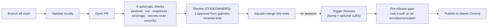

# Development and validation workflow

_[Também disponível em português](fluxo-de-desenvolvimento.md)._

How a change goes from code to a published Maven Central version, and how to validate at each
step that everything is correct.

## Overview



## 1. Before opening a PR — validate locally

Don't wait for CI to catch what you can already see on your machine. Run whatever's relevant to
your change:

```sh
# Unit tests for core and bugsy-noop (both need to keep API parity)
./gradlew :core:testDebugUnitTest :bugsy-noop:testDebugUnitTest

# The sample compiles under both build types — this is the build-time API parity test
# (ApiSurface.kt breaks the build if core+ui change and bugsy-noop doesn't keep up)
./gradlew :sample-android:assembleDebug :sample-android:assembleRelease

# "Release has no debug trace" gate (the same one CI runs)
./scripts/check-release-clean.sh --apk sample-android/build/outputs/apk/release/sample-android-release-unsigned.apk
```

If you touched anything visual in `ui` (Compose), also:

```sh
# Check that Paparazzi snapshots still match
./gradlew :ui:testDebugUnitTest :ui:verifyPaparazziDebug

# If the visual change is intentional, re-record the reference images
./gradlew :ui:recordPaparazziDebug
```

If you touched iOS, the equivalent only runs on macOS:

```sh
./gradlew :core:iosSimulatorArm64Test :bugsy-noop:iosSimulatorArm64Test :ui:iosSimulatorArm64Test
./gradlew :ui:linkDebugFrameworkIosSimulatorArm64 :ui:iosSimulatorArm64AggregateResources
xcodebuild -project sample-ios/BugsySample.xcodeproj -scheme BugsySample -sdk iphonesimulator \
  -configuration Release -destination 'generic/platform=iOS Simulator' build CODE_SIGNING_ALLOWED=NO ARCHS=arm64
```

## 2. Open the PR — what CI checks automatically

Six workflows run on every PR and on every push to `main`:

| Workflow | What it checks |
|---|---|
| `android.yml` | Unit tests, sample build (debug + release), "clean release" gate. |
| `ios.yml` | Simulator tests, framework + sample build in Release, the same "clean release" gate. |
| `snapshots.yml` | Paparazzi visual snapshots — doesn't block merge (`continue-on-error`), but uploads the diffs as an artifact on failure. |
| `coverage.yml` | Combined `core`+`ui` coverage via Kover, published to Codecov. |
| `secrets-scan.yml` | `gitleaks`, to catch an accidentally committed secret. |
| `security.yml` | CodeQL (insecure code patterns, SAST) + dependency review on the PR's changed dependencies. Covers part of the OWASP Top 10 that `secrets-scan.yml` doesn't (A06 — Vulnerable and Outdated Components, among others). |

The repository is on GitHub's free plan, so **none of these are required checks** — they don't
technically block the merge. What actually decides is the human review (next section). Because of
that, it's worth checking that all 6 passed even without a forced gate, before approving.

`dependabot.yml` complements this proactively: it opens a weekly bump PR whenever a dependency
(Gradle or GitHub Actions) becomes vulnerable or outdated, even without anyone touching the code.

For a deeper, more contextual review (not just automated pattern matching), run Claude Code's
`/security-review` skill before a release — it reads the actual diff/branch against the OWASP Top
10, instead of only matching static patterns.

## 3. Review and merge

`.github/CODEOWNERS` requires 1 approval from `gabriela-miranda-leite` on every file in the repo
before merging into `main`. Without that approval, the merge button stays locked.

## 4. Release — publishing a new version

Only when you want a version to reach Maven Central. Via **Actions → Release → Run workflow**:

1. Choose `bump` (`patch`/`minor`/`major`) and, optionally, a pre-release suffix
   (`alpha`, `rc1`, ...). The version is computed automatically from the current `VERSION_NAME` —
   there's no free-text version field anymore.
2. **Pre-release gate**: before any commit, the workflow publishes a disposable rc version to the
   runner's own `mavenLocal` (unsigned — only valid for this ephemeral test) and installs the real
   Android and iOS samples, on an emulator and a simulator, confirming they open without crashing.
   If this fails, nothing is committed, tagged, or published.
3. Once the gate passes: `VERSION_NAME` bump, PR + squash-merge, tag, GitHub Release with an
   auto-generated changelog, and finally `publishAndReleaseToMavenCentral`.

Full details of each step (GPG signing, credentials, what the Central Portal validates) are
documented internally (outside version control) and can be reconstructed by reading
`.github/workflows/release.yml` and `.github/workflows/pre-release.yml`.

### Testing before triggering a real release

To validate the packaged library (not just the source code) in a project of your own, without
touching Maven Central:

```sh
./gradlew :core:publishToMavenLocal :ui:publishToMavenLocal :bugsy-noop:publishToMavenLocal \
  -PVERSION_NAME=0.0.0-local -PbugsySkipSigning=true
```

This publishes the three artifacts to your `~/.m2/repository`. In your test project, add
`mavenLocal()` to the repositories and `implementation("io.github.gabriela-miranda-leite:bugsy-ui:0.0.0-local")`
(or `bugsy-noop` for the release variant). The `sample-android` and `sample-ios` apps already cover
this flow end to end — see [`sample-android/README.en.md`](../sample-android/README.en.md#testing-a-pre-release-version)
and [`sample-ios/README.en.md`](../sample-ios/README.en.md#testing-a-pre-release-version).

You can also trigger the **Pre-release** workflow manually (without starting a release) to generate
that same rc version inside CI and make it available as a workflow artifact, with usage
instructions in the run summary — useful to confirm that the current state of `main` installs and
opens correctly before deciding to cut a release.

## Quick checklist before opening a PR

- [ ] Unit tests for `core`/`ui`/`bugsy-noop` passing
- [ ] Sample compiles in both debug **and** release (`assembleDebug`/`assembleRelease`)
- [ ] `scripts/check-release-clean.sh` passes (no debug trace in release)
- [ ] Touched UI? Paparazzi snapshots updated/matching
- [ ] Changed `core`/`ui` public API? `bugsy-noop` kept up (the release sample must keep compiling)
- [ ] No secret committed by accident
