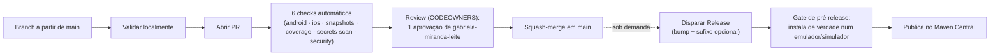

# Fluxo de desenvolvimento e validação

_[Also available in English](development-workflow.md)._

Como uma mudança sai do código até virar uma versão publicada no Maven Central, e como validar em
cada etapa que está tudo certo.

## Visão geral



## 1. Antes de abrir o PR — validar localmente

Não espere a CI pegar o que dá pra ver na sua máquina primeiro. Rode o que for relevante pra sua
mudança:

```sh
# Testes unitários de core e bugsy-noop (os dois precisam continuar em paridade de API)
./gradlew :core:testDebugUnitTest :bugsy-noop:testDebugUnitTest

# O sample compila nos dois build types — é o teste de paridade de API em build time
# (ApiSurface.kt quebra a compilação se core+ui mudarem e bugsy-noop não acompanhar)
./gradlew :sample-android:assembleDebug :sample-android:assembleRelease

# Gate de "release não carrega rastro de debug" (o mesmo que a CI roda)
./scripts/check-release-clean.sh --apk sample-android/build/outputs/apk/release/sample-android-release-unsigned.apk
```

Se você tocou em algo visual do `ui` (Compose), também:

```sh
# Confere se os snapshots do Paparazzi continuam batendo
./gradlew :ui:testDebugUnitTest :ui:verifyPaparazziDebug

# Se a mudança visual é intencional, regrava as imagens de referência
./gradlew :ui:recordPaparazziDebug
```

Se tocou em iOS, o equivalente roda só em macOS:

```sh
./gradlew :core:iosSimulatorArm64Test :bugsy-noop:iosSimulatorArm64Test :ui:iosSimulatorArm64Test
./gradlew :ui:linkDebugFrameworkIosSimulatorArm64 :ui:iosSimulatorArm64AggregateResources
xcodebuild -project sample-ios/BugsySample.xcodeproj -scheme BugsySample -sdk iphonesimulator \
  -configuration Release -destination 'generic/platform=iOS Simulator' build CODE_SIGNING_ALLOWED=NO ARCHS=arm64
```

## 2. Abrir o PR — o que a CI confere automaticamente

Seis workflows rodam em todo PR e em todo push em `main`:

| Workflow | O que confere |
|---|---|
| `android.yml` | Testes unitários, build do sample (debug + release), gate de "release limpo". |
| `ios.yml` | Testes no simulador, build do framework + sample em Release, mesmo gate de "release limpo". |
| `snapshots.yml` | Snapshots visuais do Paparazzi — não bloqueia merge (`continue-on-error`), mas sobe as diferenças como artifact se falhar. |
| `coverage.yml` | Cobertura combinada de `core`+`ui` via Kover, publicada no Codecov. |
| `secrets-scan.yml` | `gitleaks`, pra pegar segredo commitado por engano. |
| `security.yml` | CodeQL (padrões de código inseguro, SAST) + dependency review nas dependências alteradas do PR. Cobre parte do OWASP Top 10 que o `secrets-scan.yml` não cobre (A06 — Vulnerable and Outdated Components, entre outros). |

O repositório está no plano free do GitHub, então **nenhum desses é um required check** — eles não
bloqueiam o merge tecnicamente. O que de fato decide é a review humana (próxima seção). Por isso,
antes de aprovar ou pedir aprovação, vale olhar se os 6 checks passaram mesmo sem bloqueio forçado.

O `dependabot.yml` complementa isso de forma proativa: abre PR de bump semanalmente quando uma
dependência (Gradle ou GitHub Actions) fica vulnerável ou desatualizada, mesmo sem ninguém tocar
no código.

Pra uma revisão mais profunda e contextual (não só padrões automáticos), rode a skill
`/security-review` do Claude Code antes de um release — ela lê o diff/branch de verdade contra o
OWASP Top 10, em vez de só casar padrões estáticos.

## 3. Review e merge

`.github/CODEOWNERS` exige 1 aprovação de `gabriela-miranda-leite` em todo arquivo do repo antes do
merge em `main`. Sem essa aprovação, o botão de merge não libera.

## 4. Release — publicar uma versão nova

Só quando quiser que uma versão chegue no Maven Central. Via **Actions → Release → Run workflow**:

1. Escolher `bump` (`patch`/`minor`/`major`) e, se for o caso, um sufixo de pre-release
   (`alpha`, `rc1`, ...). A versão é calculada automaticamente a partir do `VERSION_NAME` atual —
   não existe mais campo de texto livre pra digitar a versão.
2. **Gate de pré-release**: antes de qualquer commit, o workflow publica uma versão rc descartável
   no `mavenLocal` do próprio runner (sem assinatura — só vale pra esse teste efêmero) e instala os
   samples Android e iOS de verdade, num emulador e num simulador, confirmando que abrem sem
   crashar. Se isso falhar, nada é commitado, taggeado ou publicado.
3. Passando o gate: bump de `VERSION_NAME`, PR + squash-merge, tag, GitHub Release com changelog
   automático, e por fim `publishAndReleaseToMavenCentral`.

Detalhes completos de cada etapa (assinatura GPG, credenciais, o que valida no Central Portal) estão
documentados internamente (fora do controle de versão) e podem ser reconstruídos lendo
`.github/workflows/release.yml` e `.github/workflows/pre-release.yml`.

### Testar antes de disparar um release de verdade

Pra validar a lib empacotada (não só o código-fonte) num projeto seu, sem tocar no Maven Central:

```sh
./gradlew :core:publishToMavenLocal :ui:publishToMavenLocal :bugsy-noop:publishToMavenLocal \
  -PVERSION_NAME=0.0.0-local -PbugsySkipSigning=true
```

Isso publica os três artefatos no seu `~/.m2/repository`. No projeto de teste, adicione
`mavenLocal()` aos repositórios e `implementation("io.github.gabriela-miranda-leite:bugsy-ui:0.0.0-local")`
(ou `bugsy-noop` pra variante release). Os apps `sample-android` e `sample-ios` já cobrem esse fluxo
de ponta a ponta — veja [`sample-android/README.md`](../sample-android/README.md#testando-uma-versão-de-pré-release)
e [`sample-ios/README.md`](../sample-ios/README.md#testando-uma-versão-de-pré-release).

Além disso, rodar o workflow **Pre-release** manualmente (sem disparar um release) gera essa mesma
versão rc dentro do CI e a disponibiliza como artifact da execução, com instruções de uso no resumo
da run — útil pra confirmar que o estado atual da `main` instala e abre antes de decidir fazer um
release.

## Checklist rápido antes de abrir o PR

- [ ] Testes unitários de `core`/`ui`/`bugsy-noop` passando
- [ ] Sample compila em debug **e** release (`assembleDebug`/`assembleRelease`)
- [ ] `scripts/check-release-clean.sh` aprovado (nenhum rastro de debug no release)
- [ ] Mudou UI? Snapshots do Paparazzi atualizados/batendo
- [ ] Mudou API pública de `core`/`ui`? `bugsy-noop` acompanhou (o sample em release não pode parar de compilar)
- [ ] Nenhum segredo commitado por engano
